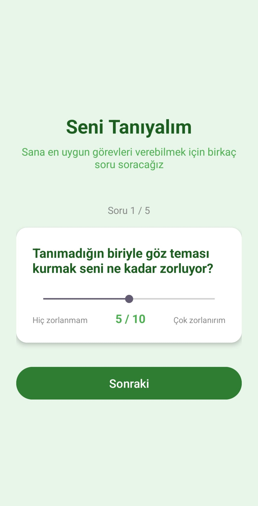
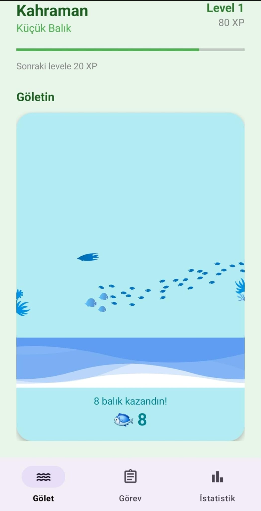
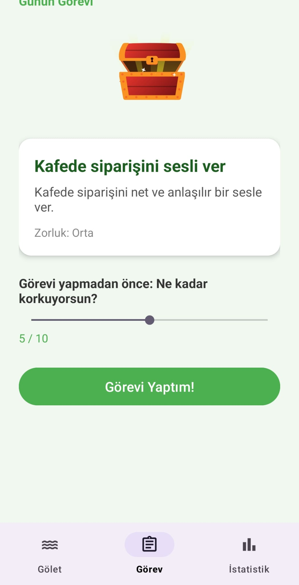
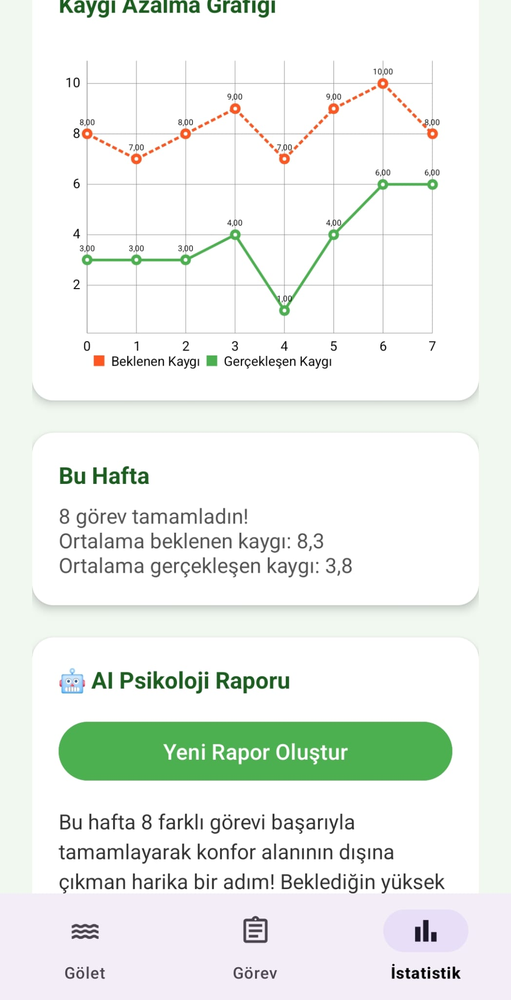
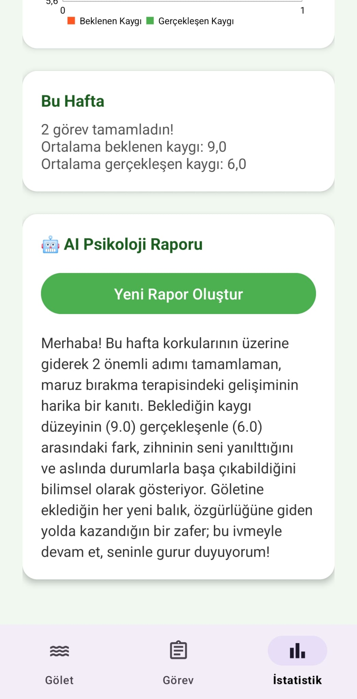

# Pondora

An Android app that helps people with social anxiety practise exposure, one small
task at a time — and shows them the gap between the fear they expected and the fear
they actually felt.

`Kotlin` · `MVVM` · `Room` · `Coroutines/Flow` · `Retrofit` · `WorkManager` · `MPAndroidChart` · `Lottie` · **35 classes** · **offline-first** · **18 seeded tasks**

<p align="center">
  
  
  
  
</p>

> **Status:** academic project, not released. The AI report feature needs your own
> API key to run (see [Configuration](#configuration)).

## What I built

- **A graded task system.** 18 hand-written exposure tasks at three difficulty
  levels; the next task is chosen from the user's anxiety score and their progress.
- **A before/after measurement loop.** The user rates the anxiety they expect and
  the anxiety they actually felt, and the app plots the two lines against each other.
  The gap between them is the product.
- **Offline-first architecture.** Room is the source of truth; the only online
  feature is an optional LLM-written weekly summary.




The chart is the core of the app: the orange dashed line is the anxiety the user
predicted, the green line is what they actually felt.

## Why

Avoidance keeps social anxiety alive: the feared situation never happens, so the
prediction that it *would* be catastrophic is never tested. Exposure therapy works,
but homework is hard to sustain alone — people skip it, and when they do it, they
rarely record what actually happened.

Pondora turns that into a daily loop:

1. **Onboarding** asks five questions and derives a starting anxiety level.
2. **A daily task** is picked from a graded list (18 tasks, difficulty 1–3) matching
   that level and the user's progress.
3. **Before and after** each task, the user rates the anxiety they expect and the
   anxiety they experienced.
4. **Stats** plots expected vs. actual and computes the *cognitive bias*: how much
   the mind over-predicted.
5. **A weekly report** is written by an LLM from those numbers, in Turkish, framed
   as encouragement rather than a score.

The pond is the progression metaphor: completing tasks earns XP and adds a duck,
and every 100 XP promotes the user to a new level title.

## Architecture

MVVM with a strict layer split, Room for persistence, and no network dependency for
the core loop — the app is fully usable offline, the LLM report is the only optional
online feature.

```
app/src/main/java/com/example/pondora/
├── data/
│   ├── db/            Room: AppDatabase, entities, DAOs, TaskSeeder
│   ├── remote/        Retrofit clients for OpenAI-compatible + Anthropic APIs
│   └── repository/    one repository per aggregate (User, Task, Score)
├── domain/usecase/    pure logic, no Android imports
│   ├── AssignTaskUseCase        picks difficulty from anxiety level + progress
│   ├── GamificationUseCase      XP, levels, duck count
│   ├── AnalyzeProgressUseCase   cognitive bias %, habituation rate
│   └── GenerateReportUseCase    builds the prompt, calls the LLM
├── ui/                Fragments + ViewModels, ViewBinding, Navigation
└── util/              notification scheduling (WorkManager), extensions
```

**Stack:** Kotlin · Room (KSP) · Navigation Component · ViewBinding · Coroutines +
Flow · Retrofit/OkHttp · MPAndroidChart · Lottie · WorkManager · Gemini/Anthropic/OpenRouter SDKs

## Design decisions and trade-offs

These are the parts worth discussing, not the happy path:

**Difficulty is chosen by anxiety level, not by success rate.** `AssignTaskUseCase`
maps the onboarding anxiety score to a difficulty ceiling and lets XP unlock harder
tasks. Trade-off: it cannot detect a user who is ready to jump ahead, and it cannot
detect one who is quietly failing. A real product would need per-task completion
signals (skipped, abandoned, retried) to adapt.

**Cognitive bias is computed per week as `(expected − actual) / expected`.** It is
deliberately simple and explainable — a user can read the number and know where it
came from. Trade-off: it divides by the *average* expected value, so a single
9/10 outlier in an otherwise calm week skews it. Per-task deltas with a median
would be more robust, and it is the first thing I would change.

**The LLM writes the report from numbers the app already computed.** The model never
sees raw personal data and never decides the content of the feedback — it rephrases
a summary the app owns. This keeps the output stable and keeps the privacy story
simple: the prompt carries counts and averages, not free text from the user.

**API keys are injected at build time, never committed.** See
[Configuration](#configuration). The keys live in `local.properties`, which is
gitignored; `BuildConfig` fields are generated from it. This is deliberately
build-time rather than remote-config because the project has no backend — and it is
also its main limitation.

**Known limitations**

- Keys shipped inside an APK are extractable. For anything public-facing the model
  calls must move behind a small server that holds the key. The current design is
  acceptable for a local/portfolio build and is called out rather than hidden.
- The task list is seeded statically (18 hand-written tasks, Turkish only). No
  localisation layer yet.
- `HttpLoggingInterceptor` is `BASIC` in debug and `NONE` in release; the previous
  `BODY` level would have logged request headers, including API keys, to logcat.
- No instrumentation tests beyond the generated stubs. The XP/level arithmetic in
  `GamificationUseCase` is pure and easy to test, but it is still untested — that
  is the next thing I would fix.

## Configuration

Create `local.properties` in the project root (it is gitignored) and add the keys
for the features you want to use:

```properties
sdk.dir=/path/to/Android/Sdk

# Optional — only needed for the weekly AI report
OPENAI_API_KEY=sk-or-...
ANTHROPIC_API_KEY=sk-ant-...
GEMINI_API_KEY=AIza...
```

Empty values are fine: the app builds and the offline loop works, only the report
button fails. A template is provided in `local.properties.example`.

## How to run

Requires Android Studio (Ladybug or newer) and JDK 17.

```bash
git clone https://github.com/<username>/pondora.git
cd pondora
cp local.properties.example local.properties   # then fill in sdk.dir
./gradlew assembleDebug
```

Or open the folder in Android Studio and press Run. `minSdk` is 26, `targetSdk` 35.

## Licence

MIT — see [LICENSE](LICENSE).
